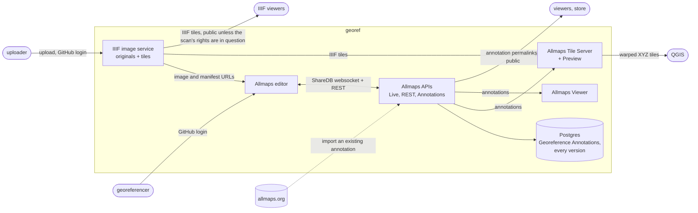

# georef

Lineage IIIF serving, self-hosted Allmaps, and annotation server.

Part of [Lineage](https://github.com/line-age/controlplane). What this component takes in,
what it puts out, and what it depends on are described in the controlplane's
[components.md](https://github.com/line-age/controlplane/blob/main/components.md#georef);
this README will say how it is built once it is.

New to GIS, IIIF or Allmaps? Start with [docs/background.md](docs/background.md).

Work is tracked in the [Georef](https://github.com/orgs/line-age/projects/3) project. The
team lead is [@nickmarden](https://github.com/nickmarden). If that changes, the
[controlplane's table](https://github.com/line-age/controlplane#projects-and-leads) is updated first.

## Architecture

Everything a map needs, from scan to georeference, runs inside `georef`. Nothing depends
on allmaps.org; existing annotations there can be imported but are never required.

- **IIIF image service** ([#1](https://github.com/line-age/georef/issues/1)). Uploading
  needs a GitHub login in an allowed team. Anyone can download, except for scans whose
  copyright is in question; those need a login too.
- **Allmaps editor** ([#2](https://github.com/line-age/georef/issues/2)). It opens sheets
  by their IIIF URLs from the image service. Editing needs a GitHub login in an allowed
  team.
- **Allmaps APIs** (#2). Allmaps' own Live (a ShareDB websocket), REST and Annotations
  APIs, run on Node against our Postgres. They store what the editor saves: one Georeference Annotation
  per sheet, in the IIIF georeference extension format. Each annotation holds the
  sheet's control points (pixel position paired with longitude and latitude), the mask
  around the map area, and the transformation type. Every saved version is kept, with
  the GitHub identity of who saved it and when.
- **Allmaps Tile Server, Preview and Viewer**
  ([#5](https://github.com/line-age/georef/issues/5)). The Tile Server turns an
  annotation and the image service's tiles into warped XYZ map tiles, which is how a
  georeferenced sheet opens in QGIS. Preview makes thumbnails; the Viewer shows warped
  maps in the browser. allmaps.org runs all three on Cloudflare; we run our own.

Allmaps publishes all of it: the editor, viewer, tile server, preview and the APIs. What's
missing for self-hosting is a Node build of the REST and Annotations APIs, configurable
auth hostnames, authentication and attribution in Live, Node builds of the editor and
viewer, and nothing builds for containers today. We've asked upstream what they'd take
([#4](https://github.com/line-age/georef/issues/4),
[allmaps#672](https://github.com/allmaps/allmaps/discussions/672)): what we write for
self-hosting should go back to Allmaps where they'll take it.

Login is GitHub, limited to a configurable list of GitHub teams (L-0012), because Lineage already
organizes people by GitHub team and Allmaps already supports GitHub login.

Nothing here yet.
