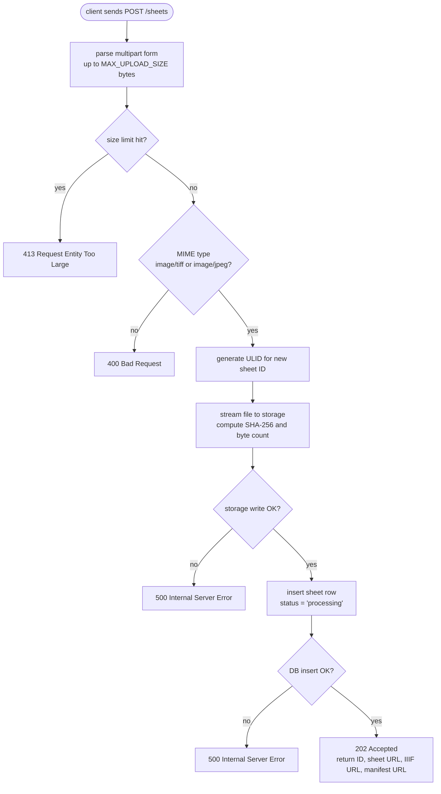
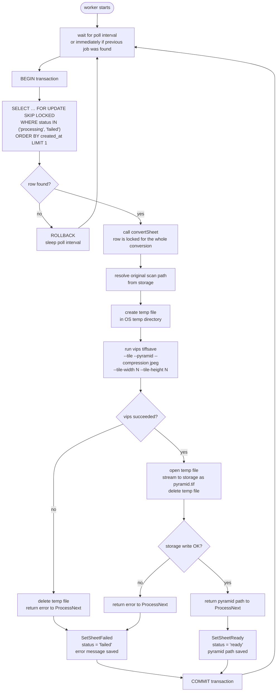
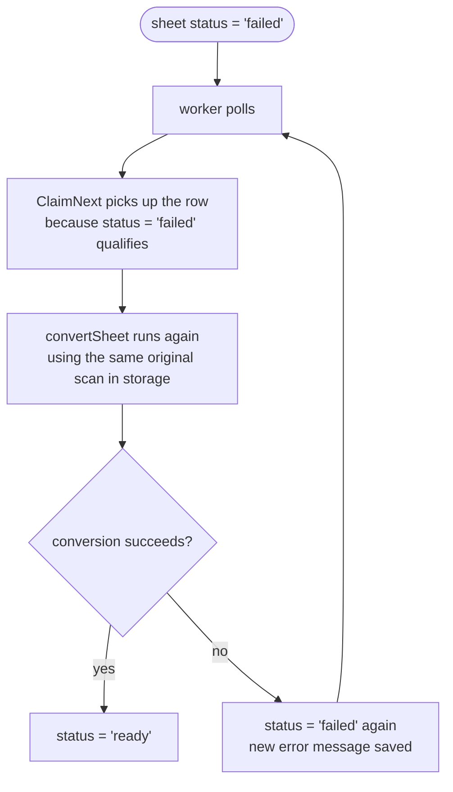
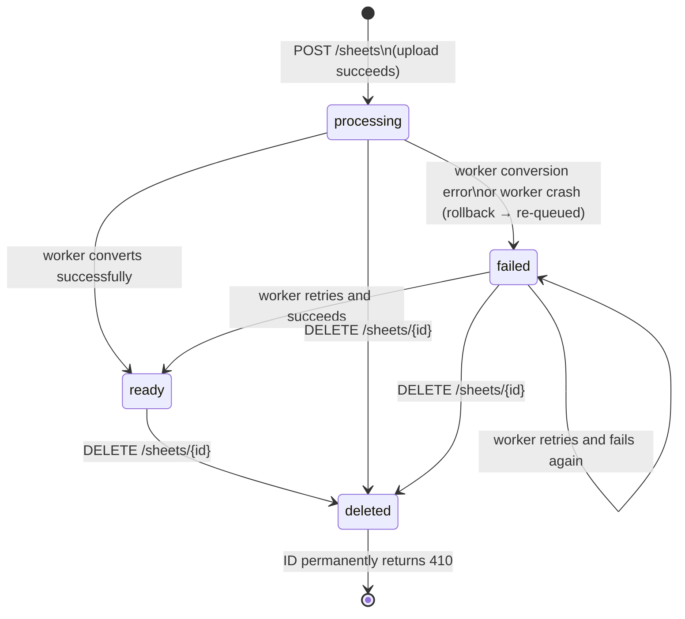

# Upload and worker flows

This document explains what happens when a scan is uploaded and how the worker
converts it into a tile-ready pyramidal TIFF. It covers the happy path and what
happens when conversion fails.

## Upload flow

When a client sends `POST /sheets`, the server processes the request in three
steps: validate the file, store it, then write the database record.



### Key points

- **The ID is a ULID**, not an auto-increment integer. It is stable forever and
  safe to embed in IIIF annotations.
- **The file is streamed**, not buffered — the server reads the upload once,
  writing bytes to storage and feeding the SHA-256 hash in a single pass.
- **Status starts as `processing`** immediately. The client can poll
  `GET /sheets/{id}` or wait for a `503 Retry-After` on IIIF requests until
  the worker finishes.
- **IIIF URLs are stable from this moment.** The sheet URL, IIIF base URL and
  manifest URL returned in the `202` response never change, even before
  conversion completes.

---

## Worker flow

The worker runs as a separate process. It polls Postgres for sheets to convert
and processes them one at a time.



### How the queue works

The worker does not need a separate job queue. The `sheets` table itself is the
queue. `ProcessNext` opens a database transaction and runs:

```sql
SELECT * FROM sheets
WHERE status IN ('processing', 'failed')
ORDER BY created_at
LIMIT 1
FOR UPDATE SKIP LOCKED;
```

`FOR UPDATE` locks the row so no other worker can claim the same sheet.
`SKIP LOCKED` means other workers do not wait — they move on to the next
available sheet immediately. This lets multiple worker instances run safely
without coordinating with each other.

The lock is held for the entire conversion. When `convertSheet` returns, the
worker writes the final status (`ready` or `failed`) and commits — releasing
the lock in the same step.

### Atomic file writes

vips writes to a temporary file, not directly to storage. Once vips finishes
successfully, the worker streams that temp file into the storage layer:

- **Local filesystem:** writes to a temp path, then renames it to the final
  path in one `os.Rename` call. Rename is atomic on POSIX — a reader never
  sees a half-written file.
- **S3:** uploads as a single PUT request. S3 does not expose partial objects
  until the PUT completes.

The temp file is always deleted, whether conversion succeeded or not.

---

## Retry flow

A failed sheet is not stuck. Because `ClaimNext` picks up rows with
`status IN ('processing', 'failed')`, any failed sheet is eligible for the
next conversion attempt on the next poll.



### What this means in practice

- **Transient failures** (a vips crash, a full disk that gets cleared, a
  network blip to S3) resolve on their own the next time the worker polls.
- **Permanent failures** (a corrupt scan that vips cannot parse) will be
  retried on every poll cycle indefinitely. There is no retry counter yet.
  To stop retrying a permanently broken sheet, delete it and re-upload a
  corrected file.
- **Worker crash mid-conversion:** if the worker dies while `convertSheet` is
  running, the transaction is never committed. Postgres rolls it back
  automatically, returning the row to `status = 'processing'`. The next worker
  that polls picks it up and tries again.

> **Future work:** add a `retry_count` column to the `sheets` table and a
> `MAX_RETRIES` check in `ClaimNext`. A sheet that exceeds the limit would stay
> `failed` and not be re-queued, preventing an infinite retry loop for
> permanently corrupt files.

---

## Sheet status lifecycle


