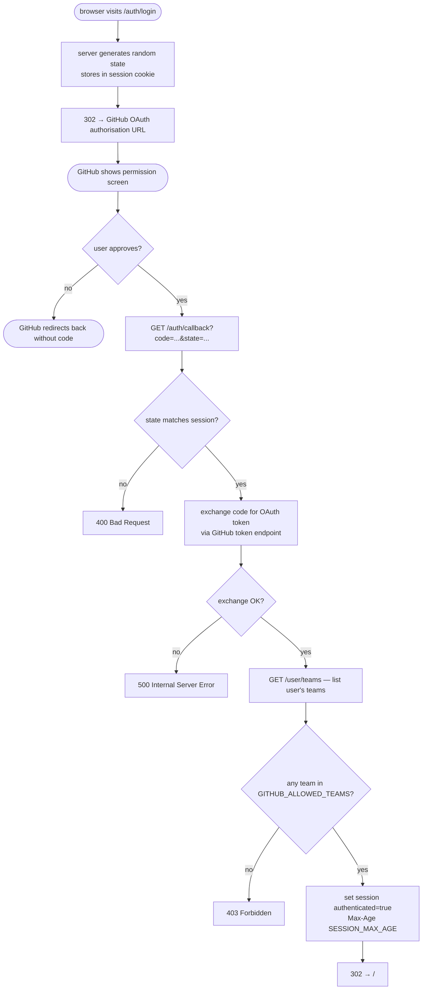
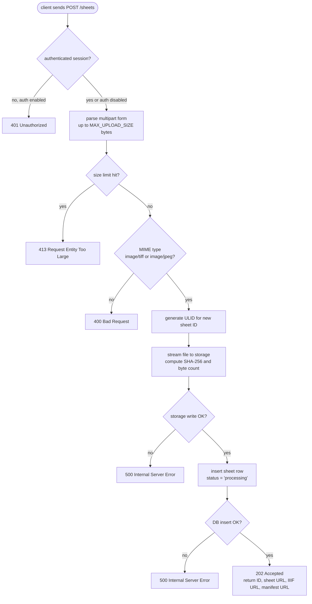
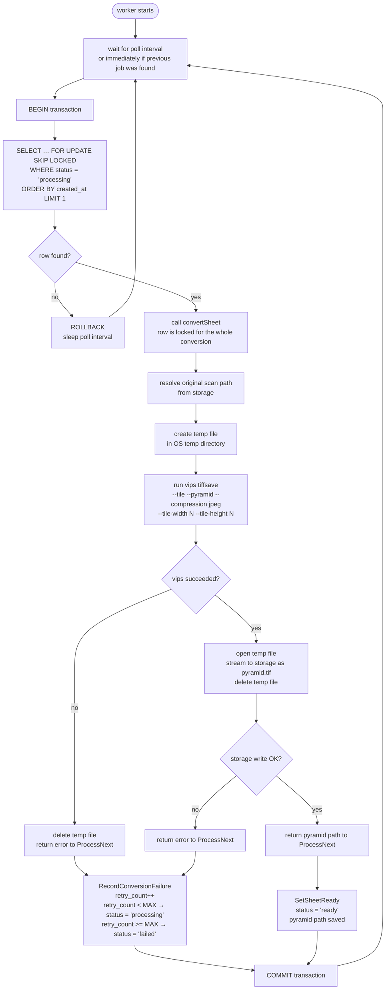
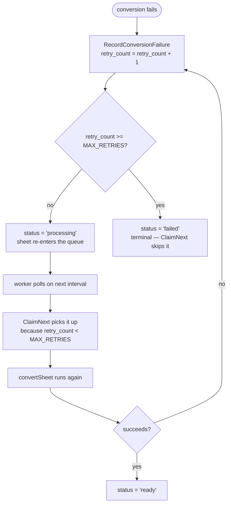
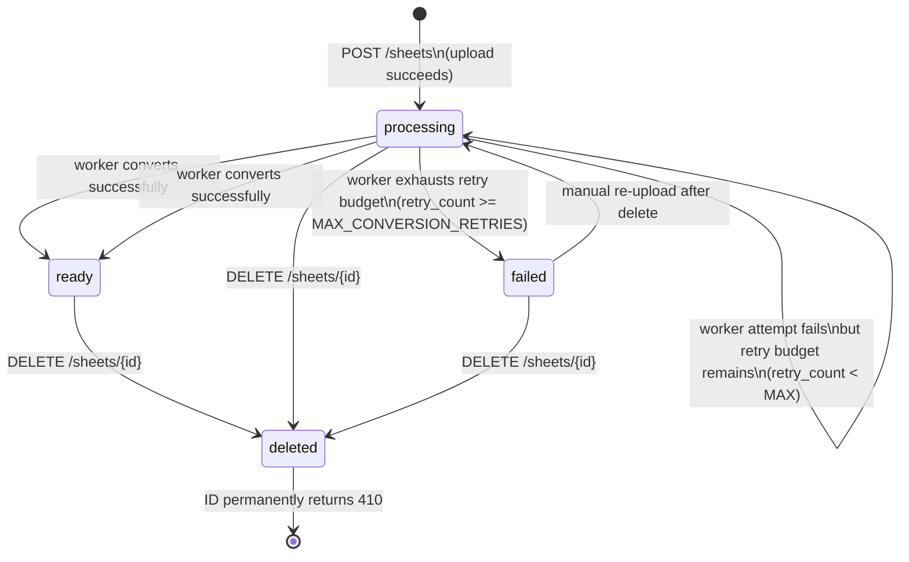
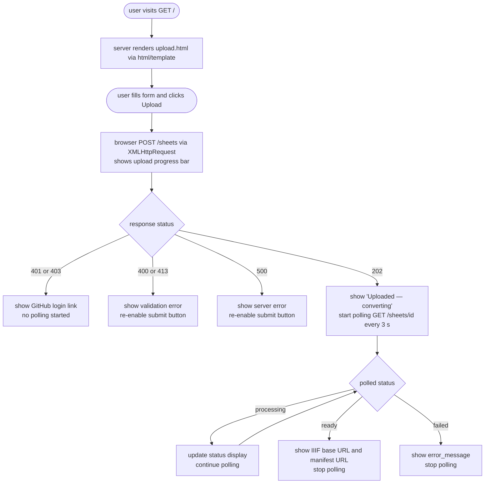

# Upload and worker flows

This document explains what happens when a scan is uploaded and how the worker
converts it into a tile-ready pyramidal TIFF. It covers the happy path and what
happens when conversion fails.

## Auth flow

Write endpoints (`POST /sheets`, `PATCH /sheets/{id}`, `DELETE /sheets/{id}`)
require a GitHub session in a configured team. Authentication is disabled when
`GITHUB_CLIENT_ID` is not set, or when `AUTH_REQUIRED=false` — in both cases
all requests pass through (useful for local development).



### Key points

- **State parameter** prevents CSRF on the callback — the server generates a
  random nonce, stores it in the session, and rejects callbacks where the
  `state` query param does not match.
- **Team check happens once at login.** The session stores `authenticated=true`
  and expires after `SESSION_MAX_AGE` (default 7 days). On expiry the user
  re-authenticates and the team membership is re-checked.
- **`RequireWrite` middleware** checks only the session flag — no Postgres hit,
  no GitHub API call per request.
- **`RequireRead` middleware** gates IIIF endpoints when `READ_LOGIN_REQUIRED=true`.
  It accepts the same session cookie, or an `Authorization: Bearer <SERVICE_CREDENTIAL>`
  header for server-side callers that cannot use a browser session. When
  `READ_LOGIN_REQUIRED` is false (the default), `RequireRead` is a passthrough.
  See `docs/auth.md` for the full read-login design.
- **Per-sheet private access.** Even when `READ_LOGIN_REQUIRED=false`, a sheet
  with `public=false` requires a valid session or service credential. This check
  runs inside `resolveReadySheet` after the status check and returns `401` for
  unauthenticated requests. The `Cache-Control` header is always `private` for
  private sheets, regardless of the global flag.
- **Disabled mode** — when `GITHUB_CLIENT_ID` is unset or `AUTH_REQUIRED=false`,
  both `RequireWrite` and `RequireRead` are passthroughs and the `/auth/*` routes
  redirect immediately to `/`.

---

## Upload flow

When a client sends `POST /sheets`, the server checks auth, then processes the
request in three steps: validate the file, store it, write the database record.



### Key points

- **The ID is a ULID**, not an auto-increment integer. It is stable forever and
  safe to embed in IIIF annotations.
- **The file is streamed**, not buffered — the server reads the upload once,
  writing bytes to storage and feeding the SHA-256 hash in a single pass.
- **Status starts as `processing`** immediately. The client can poll
  `GET /sheets/{id}` or wait for a `503 Retry-After` on IIIF requests until
  the worker finishes.
- **IIIF URLs are stable from this moment.** The sheet URL, IIIF base URL and
  manifest URL returned in the `202` response never change, even before
  conversion completes.
- **Visibility defaults to public.** The uploader can set `public=false` in the
  form or API to mark a sheet private at upload time. Visibility can be changed
  at any time via `PATCH /sheets/{id}` or via the `/manage` page.

---

## Worker flow

The worker runs as a separate process. It polls Postgres for sheets to convert
and processes them one at a time.



### How the queue works

The worker does not need a separate job queue. The `sheets` table itself is the
queue. `ProcessNext` opens a database transaction and runs:

```sql
SELECT * FROM sheets
WHERE status = 'processing'
  AND retry_count < $1   -- $1 = MAX_CONVERSION_RETRIES; skips terminal sheets
ORDER BY created_at
LIMIT 1
FOR UPDATE SKIP LOCKED;
```

`FOR UPDATE` locks the row so no other worker can claim the same sheet.
`SKIP LOCKED` means other workers do not wait — they move on to the next
available sheet immediately. This lets multiple worker instances run safely
without coordinating with each other.

The lock is held for the entire conversion. When `convertSheet` returns, the
worker writes the final status (`ready`, `processing` for retry, or `failed`
when the retry budget is exhausted) and commits — releasing the lock in the
same step.

### Atomic file writes

vips writes to a temporary file, not directly to storage. Once vips finishes
successfully, the worker streams that temp file into the storage layer:

- **Local filesystem:** writes to a temp path, then renames it to the final
  path in one `os.Rename` call. Rename is atomic on POSIX — a reader never
  sees a half-written file.
- **S3:** uploads as a single PUT request. S3 does not expose partial objects
  until the PUT completes.

The temp file is always deleted, whether conversion succeeded or not.

---

## Retry flow

Retries are bounded. Each failed attempt increments `retry_count` on the
sheet. `ClaimNext` only picks up rows where `retry_count < MAX_CONVERSION_RETRIES`
(default 3), so a permanently broken sheet is not retried indefinitely.



### What this means in practice

- **Transient failures** (a vips crash, a full disk that gets cleared, a
  network blip to S3) resolve on their own within `MAX_CONVERSION_RETRIES`
  attempts.
- **Permanent failures** (a corrupt scan that vips cannot parse) are retried
  up to `MAX_CONVERSION_RETRIES` times, then the sheet is marked `failed`
  and left untouched. To retry again, delete the sheet and re-upload.
- **Worker crash mid-conversion:** if the worker dies while `convertSheet` is
  running, the transaction is never committed. Postgres rolls it back
  automatically, returning the sheet to its previous status without
  incrementing `retry_count`. The next worker that polls picks it up.

---

## Sheet status lifecycle



**IIIF cache on delete.** The IIIF status lookup uses a short TTL cache (default 5 s). On
`DELETE /sheets/{id}`, the cache entry is invalidated immediately — IIIF endpoints return
`410 Gone` as soon as the delete completes, not after the TTL elapses.

**Unknown status.** If a future migration adds a new status value that the IIIF routing
code does not recognise, `resolveReadySheet` returns `500 Internal Server Error` and logs
the unexpected value rather than silently proxying to the image server.

---

## Upload form flow

The web form at `GET /` lets a user upload a scan from the browser without
calling the API directly.



### Key points

- **Login hint.** A `401` or `403` from `POST /sheets` shows a link to
  `/auth/login` rather than an error. The form is served without auth so anyone
  can visit it; only the submit step requires a session.
- **Polling.** The form polls `GET /sheets/{id}` every 3 seconds. This is a
  simple interval loop — no websocket, no server-sent events.
- **Upload progress.** The form uses `XMLHttpRequest` (not `fetch`) so it can
  listen to `xhr.upload.progress` events. A progress bar shows percentage
  complete as the file transfers.
- **No framework.** The form uses plain HTML and vanilla JS. The server renders
  it with Go's `html/template` package.
