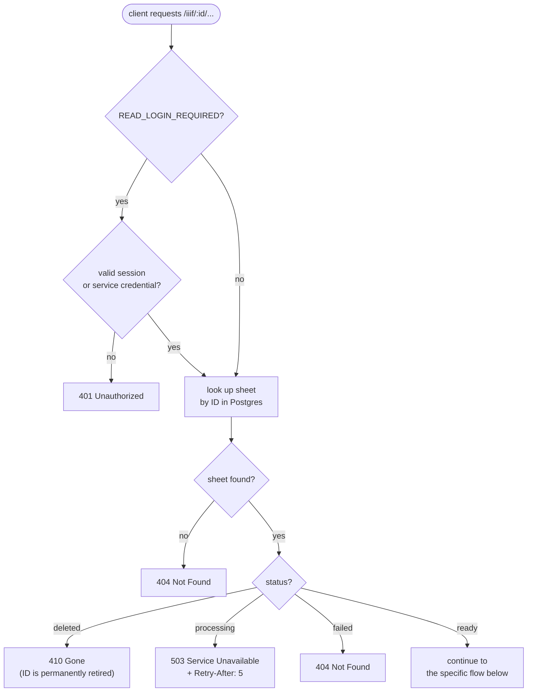
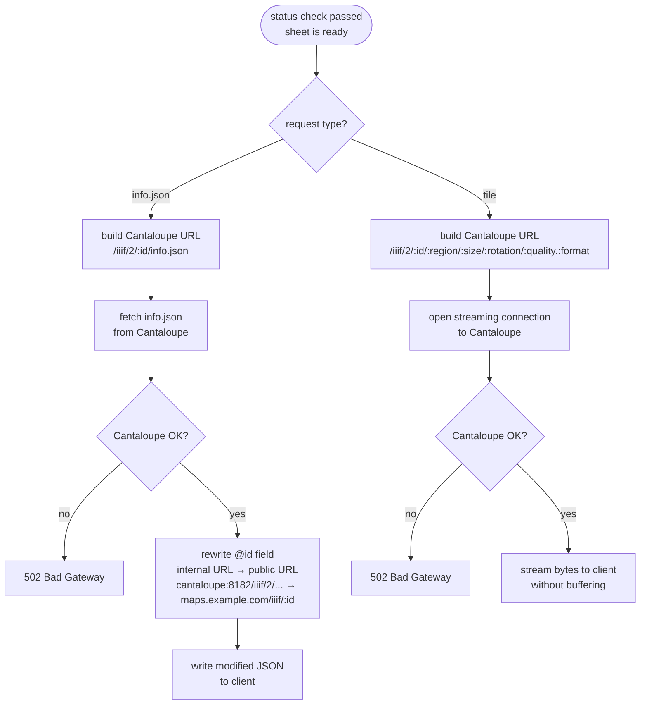
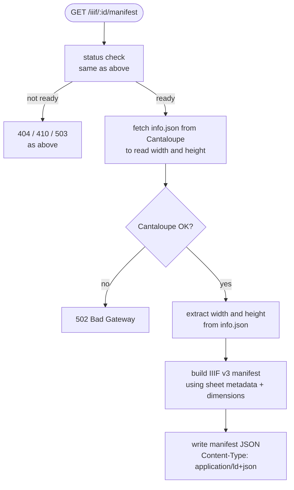

# IIIF serving flows

How the server handles requests for IIIF images and manifests. Every request
goes through a status check before anything is forwarded to the image server.
This document covers three flows: tile and info.json requests, the info.json
rewrite that hides the internal image server, and the manifest build.

---

## Status routing

Before any IIIF content is served, the server looks up the sheet in Postgres
and decides what to do based on its status. This check is the same for every
IIIF request — tile, info.json, and manifest.



### Read login

The `RequireRead` middleware runs before the status check. When
`READ_LOGIN_REQUIRED=true`, a request with neither a valid GitHub session nor an
`Authorization: Bearer <SERVICE_CREDENTIAL>` header is rejected with `401` before
the sheet is ever looked up. See `docs/auth.md` for the full read-login design.

### Why the same check for every IIIF request

The image server is internal and has no concept of sheet status — it just reads
pyramidal TIFFs from storage. Status enforcement is entirely on the front
service. By centralising the check in one helper (`resolveReadySheet`), all
three IIIF endpoints get identical behaviour without duplicating the logic.

---

## Tile and info.json flow

Once the status check passes, tiles and info.json are proxied from the
internal Cantaloupe image server.



### Why info.json needs a rewrite but tiles do not

A tile is just bytes — JPEG or PNG image data. The client uses it directly and
doesn't care where it came from.

`info.json` is different. It contains an `@id` field that tells IIIF viewers
the base URL for requesting tiles. If Cantaloupe's internal address leaked into
`@id`, viewers would try to fetch tiles from `cantaloupe:8182` — an address
that only exists inside the cluster. The proxy replaces `@id` with the public
URL before forwarding the response.

### The `/iiif/2/` version prefix

Internal Cantaloupe URLs contain `/iiif/{version}/` where `{version}` is the
IIIF Image API version. Cantaloupe serves multiple versions at different prefixes:
`/iiif/2/` for IIIF Image API v2 and `/iiif/3/` for v3. The version used here
is controlled by the `IIIF_IMAGE_API_VERSION` env var (default `2`).

The compliance level (the `level2` part of the service profile URL
`http://iiif.io/api/image/2/level2.json`) is controlled separately by
`IIIF_IMAGE_API_LEVEL` (default `2`). Level 2 means the full set of IIIF Image
API operations is supported; level 0 is the minimum (original image only).

The public URLs the Go server exposes (`/iiif/{id}/...`) have no version prefix
— that prefix only appears in the internal Cantaloupe URLs.

### How the identifier is built

Cantaloupe is configured with:
- `path_prefix = /data/storage/sheets/`
- `path_suffix = /pyramid.tif`

The identifier sent in the URL is the bare sheet ULID. Cantaloupe prepends the
prefix and appends the suffix to resolve the file:

```
identifier  : 01JEMKR9VXYZ0000000000000
→ file path : /data/storage/sheets/01JEMKR9VXYZ0000000000000/pyramid.tif
```

Using the bare ULID avoids slashes in the identifier entirely. Jetty (Cantaloupe's
embedded server) rejects `%2F` in URL path segments as a path-traversal defence,
so any identifier containing a slash would return 403.

### Cache-Control

The proxy overrides the upstream `Cache-Control` header on every IIIF response:

| `READ_LOGIN_REQUIRED` | `Cache-Control` sent to client |
|---|---|
| `false` (default) | `public` — CDNs may cache freely |
| `true` | `private` — CDNs must not cache; each viewer fetches directly |

This is set unconditionally so the value is always explicit, regardless of what
Cantaloupe returns.

### Connection reuse

The proxy uses a pooled HTTP client with up to 100 idle connections. Each
Cantaloupe request reuses an existing connection where possible. Tile responses
are streamed directly from the pool connection to the client without buffering
in memory, so large tiles don't consume server RAM.

---

## Manifest flow

A IIIF Presentation v3 manifest needs the canvas dimensions (width and height
in pixels). Those are not stored in the database, so the manifest handler
fetches them from the image server at request time.



### IIIF versions in use

| Spec | Version | How to change |
|---|---|---|
| Presentation API (manifest) | **v3** — hardcoded | Edit `presentationAPIContextURL` in `internal/iiif/manifest.go`; requires a code change |
| Image API (tiles, info.json) | **v2** default | Set `IIIF_IMAGE_API_VERSION`; must match what the image server serves |

### What is in the manifest

The manifest follows IIIF Presentation API v3. It has one canvas (one image
per sheet), with the painting annotation pointing at the IIIF image service:

```
Manifest (Presentation API v3)
└── Canvas (width × height pixels)
    └── AnnotationPage
        └── Annotation (motivation: painting)
            └── ImageBody
                ├── id: /iiif/{id}/full/max/0/default.jpg
                └── service (Image API v{IIIF_IMAGE_API_VERSION})
                    ├── v2: @id / @type keys, full profile URL
                    └── v3: id / type keys, plain level string
```

The `service` block type, profile, and JSON key names are all derived from
`IIIF_IMAGE_API_VERSION` and `IIIF_IMAGE_API_LEVEL` (defaults: v2, level 2),
so the manifest always references the same Image API version the proxy uses.

Allmaps reads this service block to find the IIIF Image API endpoint and uses
the canvas dimensions when georeferencing the image.

### Canvas IDs are URIs, not URLs

The canvas `id` (`/iiif/{id}/canvas/p1`) is a stable identifier used to link
annotations to their canvas via the `target` field. IIIF viewers read it but
never make an HTTP request to it. Nothing serves that path and nothing needs to.
This is intentional per the IIIF spec: canvas IDs are opaque URIs, not
dereferenceable endpoints.

---

## Public URL construction

Every IIIF URL the service builds follows the same pattern:

| URL | Constructed from |
|---|---|
| IIIF base | `{BASE_URL}/iiif/{id}` |
| info.json | `{BASE_URL}/iiif/{id}/info.json` |
| Tile | `{BASE_URL}/iiif/{id}/{region}/{size}/{rotation}/{quality}.{format}` |
| Manifest | `{BASE_URL}/iiif/{id}/manifest` |

`BASE_URL` is the public root (set by the `BASE_URL` env var). The image server
URL (`IMAGE_SERVER_URL`) is never exposed to clients — it appears only in
server-to-server requests.
