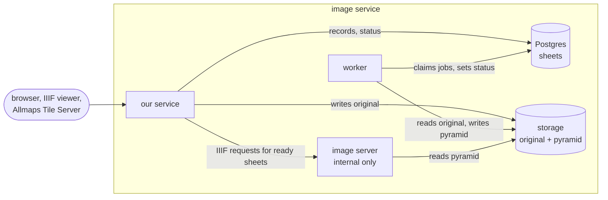

# IIIF image service: design

How the image service in [#1](https://github.com/line-age/georef/issues/1) is put together:
what each part owns, where requests go, and how a sheet gets from upload to tiles. This is
a proposal; nothing is built yet.

## Parts

- **Our service.** Takes uploads, owns the sheet records, serves the sheet API and the IIIF
  manifests, and fronts every IIIF request. It is the only part reachable from outside.
- **Postgres.** The authoritative record of every sheet: its identifier, metadata, status
  and where its files are. We can share the Postgres server that the Allmaps APIs
  ([#2](https://github.com/line-age/georef/issues/2)) use, but with a database of our own.
- **Storage.** A filesystem volume or S3-compatible object storage. It holds bytes only:
  the original as uploaded and the pyramidal TIFF built from it. Nothing in storage is
  authoritative; if the database and storage disagree, the database is right and the
  disagreement is a bug.
- **Worker.** Builds the pyramidal TIFF from the original and records the result.
- **Image server.** Cantaloupe or IIPImage, off the shelf. It turns a pyramidal TIFF into
  IIIF `info.json` and JPEG tiles. It reads storage and nothing else, never sees the
  database, and is reachable only from inside the cluster.



## Requests

| Request | Handled by | What happens |
|---|---|---|
| `POST /sheets` | our service | Upload. GitHub login in an allowed team. See below. |
| `GET /sheets`, `GET /sheets/{id}` | our service | List, search and read sheet records from Postgres. |
| `PATCH`, `DELETE /sheets/{id}` | our service | Edit metadata, delete. GitHub login in an allowed team. |
| `GET /iiif/{id}/manifest` | our service | IIIF Presentation manifest, built from the record. |
| `GET /iiif/{id}/info.json`, tiles | our service, then the image server | Checked by our service, then streamed from the image server. |

For every IIIF request our service looks up the sheet and answers itself when it should:

| Sheet | Response |
|---|---|
| unknown ID | `404` |
| deleted | `410`; the ID is never reused |
| `processing` | `503` with `Retry-After` |
| `failed` | `404` for tiles and `info.json`; the sheet API shows the error |
| read login on, no session or service credential | `401` |
| `ready` | stream the image server's response |

Only requests for `ready` sheets reach the image server, so it never has to know about
status. The lookup is cached in memory for a few seconds, because a viewer fetches dozens
of tiles for every pan and zoom.

Tiles pass through our service for these reasons:

- **Read login.** When it is on, something has to check every tile request. Checking at
  ingress (an `auth-url` call per tile) still costs a request to our service, just without
  the bytes. Doing it in the proxy keeps all access control in one place and works the
  same with either image server.
- **One code path.** Tiles go through our service whether or not read login is on, so
  there is one routing setup to test.
- **Public URLs.** Our service makes sure the `id` in `info.json` is the public URL, not
  the image server's internal address.

The proxy has to stream responses and reuse connections to the image server, and must not
buffer whole responses. Public sheets get normal cache headers; restricted sheets get
`Cache-Control: private`, so a CDN can only cache public ones.

## A sheet's life

1. **Upload.** Our service gives the sheet an opaque ID (a ULID), streams the original to
   `sheets/{id}/original` in storage, records its checksum and size, and inserts the row
   with `status = 'processing'`. It returns `202` with the ID, the sheet API URL, the IIIF
   base URL and the manifest URL. Those URLs are stable from this moment, because
   georeference annotations will point at them.
2. **Convert.** The worker claims a `processing` row with `SELECT ... FOR UPDATE SKIP
   LOCKED`, so the table is the job queue and we need no other. It builds the pyramid:

   ```sh
   vips tiffsave original pyramid.tif --tile --pyramid --compression jpeg --tile-width 256 --tile-height 256
   ```

   It writes `sheets/{id}/pyramid.tif` atomically (a temp file and a rename on a
   filesystem; a single PUT on S3), then sets `status = 'ready'`. On an error it sets
   `status = 'failed'` with the message. A worker that dies mid-job leaves the row
   claimable again.
3. **Serve.** Once the row is `ready`, IIIF requests pass through to the image server.
   Until then, clients poll `GET /sheets/{id}` (the upload form does this) or retry after
   the `503`.
4. **Retry.** A `failed` sheet can be converted again from the stored original without
   uploading it again.

The ID is a ULID and not a database sequence. It goes in every IIIF URL, so it has to
survive restores and moves between instances, and it shouldn't tell anyone how many sheets
we have. It is still the table's primary key.

## Read login

Reads are public by default. With read login on, IIIF requests need either a GitHub
session or a service credential (a bearer token, set in configuration). The service
credential is for the Allmaps Tile Server and Preview
([#5](https://github.com/line-age/georef/issues/5)), which fetch `info.json` and tiles
server-side and can't log in through a browser.

## Image server

Either Cantaloupe or IIPImage fits behind the proxy, since neither needs to do
authorization. The remaining difference is storage. Cantaloupe reads S3 directly. As far as
we know IIPImage reads only the local filesystem, so S3 storage would mean mounting the
bucket. That points to Cantaloupe, and it is the one to rule out first.

## Open

- Which image server. See above.
- Whether Cantaloupe caches a `404` for an identifier and keeps serving it after the file
  appears. Less likely to matter now, since the image server only sees requests for ready
  sheets, but worth checking.
- How long conversion takes on a real scan, to set `Retry-After` sensibly.
