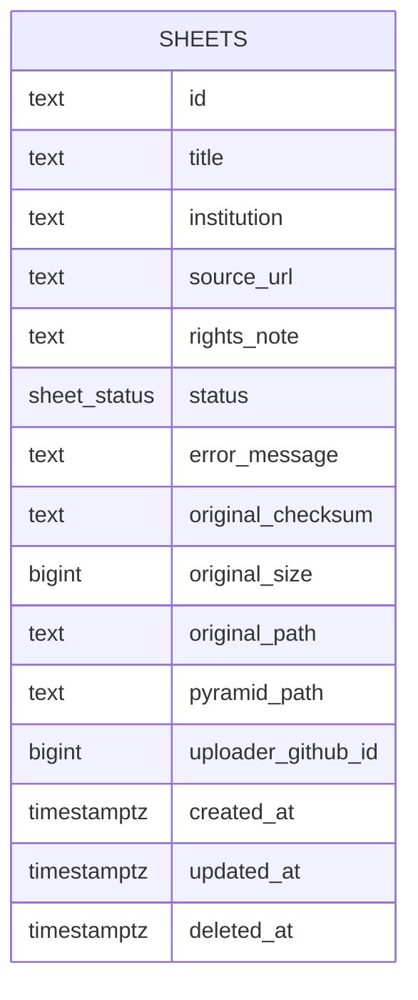

# Data model

The image service has one table: `sheets`. Every scanned map — from the moment
it is uploaded to the moment IIIF tiles are served — is a row in this table.

---

## Entity diagram

---

## Status lifecycle

A sheet moves through a fixed set of states. The table is also the job queue —
no separate queue system is needed.

```mermaid
stateDiagram-v2
    [*] --> processing : POST /sheets (upload)

    processing --> ready   : worker converts successfully
    processing --> failed  : worker encounters an error

    failed --> processing  : worker retries automatically

    processing --> deleted : soft delete while converting
    ready      --> deleted : soft delete
    failed     --> deleted : soft delete

    deleted --> deleted : ID is never reused;\nIIIF returns 410 forever
```

---

## Column reference

| Column | Type | Nullable | Description |
|---|---|---|---|
| `id` | `TEXT` | No | ULID. Primary key. Embedded in every IIIF URL. Never changes, never reused. |
| `title` | `TEXT` | No | Human-readable label for the scan. Required at upload. |
| `institution` | `TEXT` | Yes | Holding institution. Informational; shown in the manifest. |
| `source_url` | `TEXT` | Yes | URL where the scan was sourced, for attribution. |
| `rights_note` | `TEXT` | Yes | Rights or licence statement to surface in the manifest. |
| `status` | `sheet_status` | No | Processing lifecycle state. See diagram above. |
| `error_message` | `TEXT` | Yes | Populated when `status = 'failed'`. Returned by the sheet API so the team can see what went wrong and decide whether to retry. |
| `original_checksum` | `TEXT` | No | SHA-256 hex of the uploaded file. Used to verify storage round-trips. |
| `original_size` | `BIGINT` | No | File size in bytes. Recorded at upload. |
| `original_path` | `TEXT` | No | Storage-relative path (`sheets/{id}/original`). The original is never modified. |
| `pyramid_path` | `TEXT` | Yes | Storage-relative path (`sheets/{id}/pyramid.tif`). NULL until the worker sets `status = 'ready'`. |
| `uploader_github_id` | `BIGINT` | Yes | GitHub numeric user ID of whoever uploaded the sheet. Nullable until confirmed as required. |
| `created_at` | `TIMESTAMPTZ` | No | Row creation time. Used to order the worker's claim queue (oldest first). |
| `updated_at` | `TIMESTAMPTZ` | No | Updated on every write. Use this for cache invalidation. |
| `deleted_at` | `TIMESTAMPTZ` | Yes | Timestamp of soft deletion. NULL until deleted. |

---

## Design decisions

### Why a ULID and not a Postgres sequence

The ID appears in every IIIF URL the system produces. A georeference annotation
embeds that URL permanently, so the ID must survive a database restore, a
migration to a new instance, and a move between environments. A Postgres sequence
resets under these operations; a ULID does not. As a bonus, ULIDs do not reveal
the total number of sheets, which matters for a public API.

The ULID is still the primary key. Because it is sortable by generation time,
the index shape is similar to a sequence index — inserts are mostly-append,
not scattered.

### Why a Postgres enum (`sheet_status`) and not a string

A Postgres enum gives the database a closed set of valid states. The application
cannot accidentally insert an unknown status string; the constraint is enforced at
the wire, not just in Go code. The type also makes the lifecycle visible in schema
inspection tools without reading application code.

### Why the table is also the job queue

The worker claims rows with `SELECT … FOR UPDATE SKIP LOCKED`. This means:

- No second process or infrastructure component (Redis, SQS, etc.) is needed.
- The database is the single source of truth; job state and sheet state are
  always consistent.
- A worker that crashes mid-job releases its lock automatically; the row is
  immediately claimable by another worker.
- Scaling workers means running more worker containers — the locking is handled
  by Postgres.

### Why the worker handles retries automatically

The worker's claim query picks up both `processing` and `failed` rows. A `failed`
sheet still has its original in storage, so the worker can attempt conversion again
without any external trigger. This keeps the retry path identical to the initial
conversion path — no separate mechanism, no manual intervention.

A retry limit and cooldown (e.g. exponential backoff on `updated_at`) will be
implemented in Stage 5 to prevent a permanently broken file from being claimed
in a tight loop.

### Why soft delete instead of hard delete

The IIIF specification requires that a deleted resource return a permanent error,
not 404 (which implies "never existed"). We use `410 Gone` for deleted sheets.
To return 410 reliably the row must stay in the database; a hard delete would
make it indistinguishable from an unknown ID. The deleted row also ensures the
ID is never reused, which protects existing georeference annotations that
reference it.

### Why `uploader_github_id` is nullable

The column is nullable because the requirement has not been confirmed. Making it
`NOT NULL` now would require a data migration later if the requirement is dropped.
Making it nullable now costs nothing — if the requirement is confirmed, an
`ALTER TABLE … SET NOT NULL` after a backfill is a small migration.

### Why storage paths are stored and not derived

The paths (`original_path`, `pyramid_path`) could be derived from the ID with a
fixed pattern. They are stored explicitly for two reasons:

1. **Migration safety.** If the naming convention ever changes, existing sheets
   are not affected — their paths are fixed in the row.
2. **Auditability.** The path in the row is what the system actually used, not
   what the current code would compute. If a file is ever missing, the row tells
   you exactly where to look.

### Why a partial index on `status IN ('processing', 'failed')`

The worker's claim query filters on `status IN ('processing', 'failed')`. Once a
sheet reaches `ready` or `deleted` it is never claimed again. A partial index
covering only the claimable rows stays small and fast regardless of how large the
table grows; a full index on the `status` column would include all historical rows
and offer less benefit per page read.
